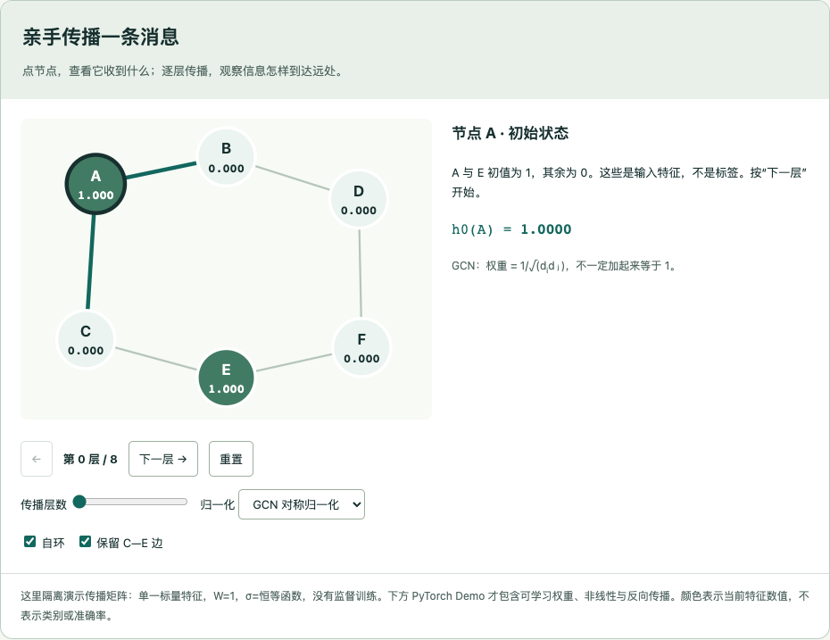

# GNN：从一条消息到一次实验

[](https://github.com/guozongzhi/GNN/actions/workflows/checks.yml)

中文图神经网络学习包：**可交互原理介绍、26 篇论文索引、25 份原始 PDF，以及可在 CPU 上训练和评估的 PyTorch Demo。** 既有部署资料核查于2026-11-10；补充论文核查于2026-11-15。



## 先看什么

| 你的目标 | 入口 |
| --- | --- |
| 查看融合补充版 | [32 页原理与关键论文 PPT](outputs/presentations/GNN-原理与关键论文-融合补充版.pptx)：结合用户提供的入门 PPT，新增任务头、GCN 向量手算、动态图、时空预测、GNN×LLM 与应用地图；[预览](outputs/presentations/GNN-融合补充版-预览.png)，[逐页讲稿](content/gnn-paper-reading-supplement.md)，[补充与修正说明](content/ppt-supplement-notes.md) |
| 查看上一版论文精读 | [24 页论文精读高密度版 PPT](outputs/presentations/GNN-关键论文精读-高密度版.pptx)：公式与符号、原图、实验协议及消融、跨论文对比；[查看预览](outputs/presentations/GNN-论文精读-高密度版-预览.png)，[逐页讲稿与原文定位](content/gnn-paper-reading-dense.md) |
| 直观看懂 GNN | [离线交互介绍](outputs/gnn-guide.html)：选节点、改边、切换归一化、逐层传消息 |
| 在 GitHub 直接阅读 | [原理与应用介绍](content/gnn-introduction.md) |
| 找经典论文与历史里程碑 | [论文索引与原始 PDF](source/paper-index.md) |
| 判断应用证据是否可靠 | [应用事实核查](content/fact-check.md) |
| 学会设计和解读实验 | [实验练习与常见问题](content/experiment-guide.md) |

GitHub 文件页显示 HTML 源码；克隆或下载整个仓库后，在浏览器打开 `outputs/gnn-guide.html` 才能使用交互。阅读页完全离线；首次安装 Python 依赖需要联网。

当前 PPT 为 16:9 中文融合补充版，更新于2026-11-15。在上一版24页精读稿上新增8页，将用户提供的15页入门PPT融入既有论文主线。新增DCRNN、TGN、两篇经典综述及图与LLM综述的原始PDF，并保留原文定位和版本哈希。已移除 Demo、运行命令和本地训练评估章节。正文展开早期 GNN、谱图卷积、GCN、MPNN、GraphSAGE、GAT、R-GCN、GIN，以及推荐、几何、全局注意力与科学应用论文。通过公式、符号定义、实验协议表和跨论文对照，提高每页的信息量；逐页备注与讲稿保留原始出处和页码。

文字、公式、表格和数据图表可编辑；论文架构图直接裁自本地原始 PDF。论文实验数值均为作者报告，本次未重新复现；既有部署证据沿用2026-11-10的核查，新增论文核验于2026-11-15。原24页高密度版、32页精读版、25页图解与实验版、20页初版保留在同目录中。仓库训练代码仍可从下方入口独立使用。

## 从零运行

需要 Python 3.12。以下命令从仓库根目录执行，适用于 macOS/Linux：

```sh
git clone https://github.com/guozongzhi/GNN.git
cd GNN
python3.12 -m venv .venv
source .venv/bin/activate
python -m pip install -r demo/requirements-lock.txt
python demo/train.py
```

已有 uv 的话，可把建环境与安装两步换成：

```sh
uv venv --python 3.12 .venv
uv pip install --python .venv/bin/python -r demo/requirements-lock.txt
source .venv/bin/activate
```

Windows 使用 `py -3.12 -m venv .venv` 创建环境，然后在 PowerShell 执行 `.venv\Scripts\Activate.ps1`；后续 `python` 命令相同。Windows 尚未在本项目 CI 中验证。

训练结束会打印 `report.html` 的位置。默认输出到 `runs/<UTC 时间戳>/`，无需改代码或配置 GPU。也可以指定目录：

```sh
python demo/train.py --out runs/first
# 打开 runs/first/report.html 查看这次实验
python demo/train.py --evaluate runs/first/gcn-7.pt --out runs/first-evaluation
```

已存在且非空的输出目录会被拒绝，避免覆盖；确认要替换时加 `--overwrite`。`runs/` 不纳入版本控制；`outputs/` 保存随仓库提供的参考实验与介绍页。

## 训练后得到什么

| 文件 | 如何使用 |
| --- | --- |
| `report.html` | 本次实验的离线报告，展开每次训练查看混淆矩阵 |
| `results.json` | 测试 Accuracy、Macro-F1、均值、样本标准差、配置和环境 |
| `*-predictions.csv` | 每个节点的 train/val/test 划分、真实/预测类别、正确与否及类别概率 |
| `*-history.csv` | 逐轮训练/验证损失与准确率 |
| `*.pt` | 验证集选出的模型权重、数据和传播矩阵，可独立重载评估 |
| `experiment.png` / `.svg` | 曲线、测试对照和节点表示投影 |

只有训练标签参与梯度；验证损失选择 checkpoint；测试集在选模后评分。预测概率未经校准。只加载自己生成或可信的 checkpoint。

## 三个实验，理解关系的作用

默认是 180 个节点、3 类、16 维特征的合成图。训练/验证/测试节点为 24/36/120。实验是**同一图上的传导式节点分类**：训练可见全图特征和边，看不到测试标签。

```sh
# 固定图、特征、划分；改变模型初始化与 dropout 随机性
python demo/train.py --data-seed 42 --seeds 7 17 27 --out runs/fixed-data
# 边不再携带社区线索
python demo/train.py --p-in .06 --p-out .06 --out runs/no-community
# 更多层，观察优化和表示变化
python demo/train.py --layers 8 --out runs/deep
```

每次都对比 GCN、MLP、仅自环 GCN 和打乱图的 GCN。**仅自环 GCN 与本实现的 MLP 等价**，是实现一致性检查，不是两项独立方法。打乱图保留图拓扑、边数与度分布，破坏图与节点特征/类别的对应关系。

不传 `--data-seed` 时，种子同时改变数据、划分和初始化；传入后则固定数据与划分，且每个种子的打乱图置换仍会变化。标准差的含义取决于这个设定，不能直接当成置信区间。

[原始参考实验](outputs/results.json)中，默认同配图 GCN 均值为 100%，MLP 为 49.7%；[无社区线索对照](outputs/no-community/results.json)中 GCN 为 40.8%。这展示了建图的重要性，**不能外推为真实基准或业务精度**。本包尚不包含 Cora 等真实数据集的论文级复现。

## 自动检查与本地验证

每次向 `main` 推送或提交 PR，GitHub Actions 检查：原始文件哈希、代码测试、阅读页构建一致性、浏览器交互、实际训练与权重重载。CI 使用 Linux/Python 3.12/CPU，并保留实验产物 7 天。

本地可以执行相同检查：

```sh
python -m pip install -r tools/requirements.txt playwright==1.51.0
python -m playwright install chromium
python tools/verify-sources.py
python -m unittest discover -s demo -p 'test_*.py'
python -m unittest discover -s tools -p 'test_*.py'
python tools/build-guide.py
python tools/check-browser.py
python tools/check-report.py runs/first
```

`check-report.py` 的目录应替换成你实际运行过的实验目录。构建介绍不会重新训练；实验也不会自动改写介绍母稿中的历史参考结果。

## 论文与溯源

`source/catalog.json` 定义阅读索引，`source/manifest.json` 记录 PDF 来源、原始下载时间、版本标记、页数、字节与 SHA-256。`source/web-manifest.json` 记录官方网页快照及明确的获取失败项。

- `python tools/verify-sources.py`：只读核验 20 份 PDF 与 6 份网页原件，无需联网。
- `python tools/fetch-papers.py`：复用已有文件或补下载。保留历史下载时间；没有可信时间时留空，不使用 clone 时间代替。若与已记录哈希不一致，保留原清单并写入 `tmp/download-report.json`。
- 更新论文版本时，应先另存旧文件与清单，再明确更新目标记录；不把新的下载结果默认为旧原文。
- Gori 2005 未取得开放全文；Scarselli 2009 是学术镜像副本；arXiv 文件不一定与出版社排版一致。论文版权归原权利人。

## 目录

| 目录 | 职责 |
| --- | --- |
| `content/` | 原创介绍、实验练习与事实核查 |
| `demo/` | 训练、评估、实验报告、依赖和测试 |
| `tools/` | 原文获取/核验、阅读页构建和浏览器检查 |
| `source/` | 原始论文、官方网页和溯源清单 |
| `outputs/` | 固定参考实验、可交互介绍与预览 |
| `runs/` | 你新生成的实验，默认忽略 |

[近期改动](CHANGELOG.md) · [CI 运行记录](https://github.com/guozongzhi/GNN/actions)
